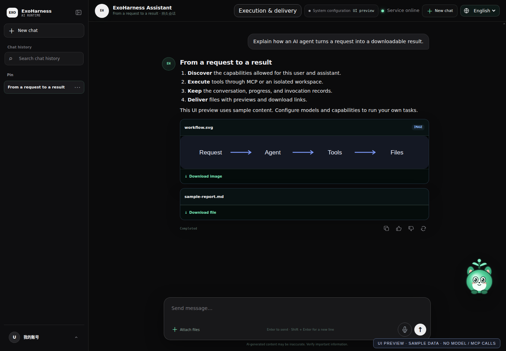
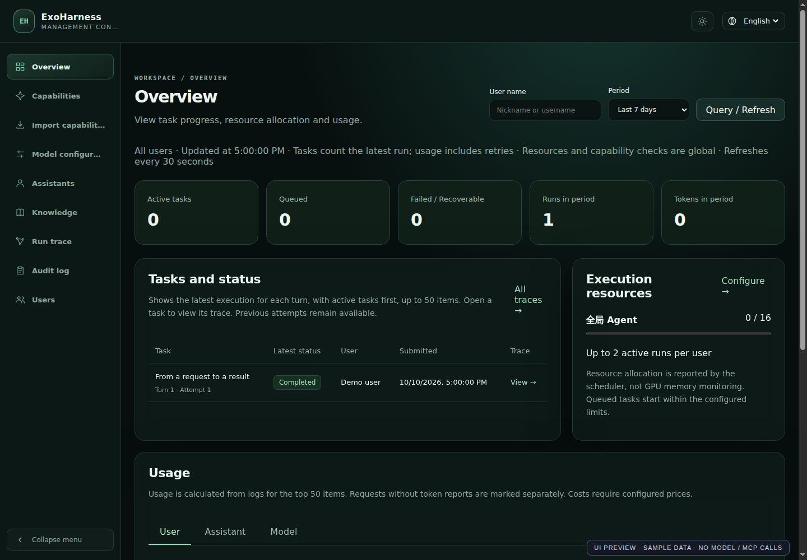

# ExoHarness

English | [简体中文](README.zh-CN.md) · [Live demo](https://agent.flyang.art/) · [Demo administration](https://harness.flyang.art/) · [Documentation](docs/README.md)

**An extensible Agent Harness in Rust, with a ready-to-use, self-hosted web console.**

Copyright © 2026 Jason Yang · [Contact](mailto:flyangqn@gmail.com)

ExoHarness provides the common runtime for AI agents: model connections, context management, capability discovery, authorization, tool execution, progress, persistence, and tracing. Developers and operators compose applications by adding Skills and MCP services, configuring models, and assigning capabilities to assistants.

The framework supports applications across different domains, from research and software engineering to business operations and content creation. Its multi-user web application gives these agents a shared chat interface, administration console, and file delivery service. The connected capabilities define each assistant's actual scope.

## See it in action

[Try the user portal](https://agent.flyang.art/) · [Administration demo](https://harness.flyang.art/) · [Download a release](https://github.com/jason571/Exoharness/releases)

**Chat, previews, and downloadable files**



**Administration: task status, execution resources, and usage**



These screenshots render the actual interface with sample data; they do not represent model or MCP executions. Reproduce them with `node scripts/capture-demo.mjs` (Node 22+ and Google Chrome). Live tasks require configured models and authorized capabilities.

## Run the Linux release

The first public preview targets **Linux x86_64 with glibc 2.39+**, such as Ubuntu 24.04. Install Python 3.11+ and Docker Engine, then download the `.tar.gz` and `SHA256SUMS` from [Releases](https://github.com/jason571/Exoharness/releases).

```bash
sha256sum --check SHA256SUMS --ignore-missing
tar -xzf exoharness-v0.1.0-linux-x86_64-gnu.tar.gz
cd exoharness-v0.1.0-linux-x86_64-gnu
docker pull postgres:18.6-alpine3.23
bash scripts/start-native.sh prepare-db
bash scripts/start-native.sh start
bash scripts/start-native.sh access
```

Open administration at `http://127.0.0.1:9797/` and the user portal at `http://127.0.0.1:9798/`. The `access` command displays private local credentials. Configure a model and assistant before submitting tasks; SMTP is required for user signup. Model credentials, capability packages, external MCP services, and the OCI execution image are supplied separately. See the bundled `README.txt` / `README.zh-CN.txt` and [Deployment](docs/DEPLOYMENT.md).

## Build your own agents and workflows

The core framework and domain capabilities have separate responsibilities:

- **Skills** supply reusable procedures, task instructions, reference material, and optional scripts.
- **MCP services** expose tools and connect agents to APIs, applications, data sources, and specialized execution services.
- **Model connections** provide reasoning and supported speech or other model-backed capabilities.
- **The Harness** handles discovery, context, permissions, invocation records, execution guards, progress, and result delivery across those capabilities.

To extend an assistant, import a compatible Skill or register an MCP service, prepare its execution dependencies, and grant access. Compatible additions use the existing discovery and execution path without changing the core Agent loop. Transport and model protocol support is documented in [Capabilities](docs/CAPABILITIES.md) and [Model configuration](docs/MODEL_CONFIGURATION_DESIGN.md).

An organization can use the same deployment for assistants with different responsibilities and tool permissions. Developers can connect their own services and compose new workflows around the framework's execution and API contracts.

## Application examples

The following examples illustrate what a configured deployment can do. They are starting points for capability composition, rather than a fixed list of supported applications.

| Example scenario | Example request | Possible deliverable and capabilities |
| --- | --- | --- |
| Research and data analysis | “Find recent US GDP figures and chart the trend.” | Search results, a chart, or a spreadsheet; uses authorized search tools and sandbox execution. |
| Office documents | “Create an entertainment industry report as a presentation.” | Downloadable PPTX, DOCX, or PDF; uses the corresponding Skills and document libraries in the sandbox. |
| Websites and coding | “Build a bilingual tourism website with a homepage and detail pages.” | Multi-file project, browser preview, and ZIP download; uses Coding and sandbox tools. |
| Images and posters | “Design a promotional poster for this company.” | Previewable image and download; uses an image-generation service and design instructions. |
| Music and video | “Make a narrated promotional video” or “Create an MV from this song.” | Audio/video files and a final combined output when the configured workflow supports it; uses generation and media-processing services. |
| Educational content | “Explain this question to a primary-school student with an animation.” | Narration and an explanatory video; uses a teaching Skill, TTS, and an animation renderer. |

Each example depends on its installed and authorized capabilities. Additional Skills and MCP services can enable other applications through the same framework. Standalone `skills/` and `mcp/` projects are distributed separately from the core repository.

## From a request to a result

1. An administrator configures model connections, imports capabilities, and assigns an assistant and permissions to users.
2. A user sends a request, optionally with reference files, through streaming chat.
3. The assistant discovers authorized capabilities and loads the tool schemas needed for the current step.
4. MCP services or isolated sandbox tools perform the work. Progress and execution records are persisted.
5. The user receives the task's response or resulting files, with previews and downloads where applicable. Administrators can inspect the request, tool calls, errors, usage, and files in Trace.

## Core features

### Multi-user chat and assistant administration

The user portal includes streaming responses, searchable history, conversation management, attachments, voice input through ASR, personal materials and memory management, and file preview/download. Administrators configure assistant identity, avatars, model choices, and capability permissions, then assign assistants to users. Both interfaces support Chinese and English.

### Skills, MCP services, and model connections

Register versioned Skill packages and remote MCP services through the management console. Tool discovery follows the user's and assistant's authorization, enabled state, and runtime readiness. Execution arguments are validated against live JSON Schemas. Model adapters connect LLM, TTS, and ASR protocols; credentials are stored separately from public capability descriptions.

### Inspectable execution

Sessions, Turns, Runs, invocation records, snapshots, and events are persisted in PostgreSQL. Trace exposes model requests, tool arguments and results, errors, Token usage, and generated files. Progress from MCP services is forwarded to the interface; declared background tasks can be polled and cancelled by the execution backend.

### Context and Token management

The execution journal keeps complete inputs and results, while model requests use a task-focused projection. ExoHarness loads tool schemas on demand, deduplicates repeated Skill instructions, and replaces eligible persisted exchanges with compact checkpoint references. Argument repair and repeated-call guards have bounded budgets. Usage statistics distinguish input, output, and cache usage. See [Context and Token management](docs/CONTEXT_AND_TOKENS.md) for the actual rules and limits.

### Isolated execution and Coding

Python, Shell, JavaScript, and TypeScript tasks run in OCI containers with resource limits, read-only package mounts, writable task workspaces, and networking disabled by default. Files can be reused and edited within a task. The Coding module adds multi-file search, exact edits and atomic patches, build/test checks, project archives, and static website previews.

### Unified deliverables

One file service handles images, audio, video, office documents, and published static projects. It records provenance and SHA-256, provides signed access, and supports Range requests for media playback. Chat displays declared final artifacts as previews or download cards.

### Knowledge and operations

Manage personal or administrator-provided materials, categories, DOCX and text-based PDF imports, structured blocks, and literal search. The administration console also provides user management, execution overviews, audit records, Run admission limits, MCP concurrency, and shared resource pools. Automatic knowledge retrieval, embeddings, and OCR are not part of the current implementation.

## Architecture at a glance

```text
Management console :9797       User portal :9798
              \                  /
                  ExoHarness
                  ├── PostgreSQL: identities, conversations, execution records
                  ├── Configuration, capability registry, and secret storage
                  ├── OCI sandbox: code, scripts, and task workspaces
                  └── MCP services and model APIs: external capabilities

File service :9790 ── downloads, media playback, static site previews
```

The listeners bind to `127.0.0.1` by default and are configurable. Source modules live in `modules/`; Rust tests live in module `tests/` directories, with script and browser tests in `scripts/tests/`.

## Technology stack

| Layer | Implementation | Source location |
| --- | --- | --- |
| Core Harness and backend | Rust: Agent loop, extensions, context, tools, permissions, database access, HTTP/SSE APIs, and file service. | `modules/` |
| Management and chat interfaces | TypeScript compiled to JavaScript, alongside HTML/CSS and existing JavaScript page code. Both interfaces run in the browser; their backend is Rust. | `web-console/src/`, `web/` |
| Build, deployment, and migration | Python scripts wrapped by Shell entrypoints. | `scripts/` |
| Tests | Rust unit/protocol/integration tests, Python scenario and script tests, and Node.js browser/interface tests. | `modules/*/tests/`, `scripts/tests/`, `web-console/tests/` |
| Task sandbox | Docker OCI containers with Python, Bash, Node.js, document libraries, and media utilities. | `modules/sandbox/`, `runtime/sandbox/` |
| Database | PostgreSQL, hosted independently or in Docker. | `modules/storage/` |

## Which environments are needed?

| Component | Purpose | When it is needed |
| --- | --- | --- |
| Rust / Cargo 1.88+ | Compile the core service. | Building from source; not needed to run a prebuilt binary. |
| Host Python 3.11+ | Run build, packaging, database preparation, startup, migration, and test scripts. | Using the supplied scripts. The core service itself is a Rust executable. |
| Host Node.js 22+ / npm | Type-check and bundle the TypeScript frontend. | Building the frontend; not needed to serve an already-built release. |
| PostgreSQL | Persist users, configuration records, conversations, execution, and knowledge data. | Running the platform. |
| Docker Engine | Run isolated task containers; optionally host PostgreSQL or the main service. | Sandbox execution or container deployment. Native core compilation does not require Docker. |
| Python / Node inside the sandbox | Execute user-task code and document-processing scripts in isolation. | Python/JS/TS tasks, document workflows, and sandbox-based document imports. |
| External model and MCP services | Perform search, speech, image, music, video, animation, or other specialized operations. | The capabilities you choose to enable. Their dependencies are managed separately. |

**Python is not only a testing dependency.** Host Python runs the supplied operational scripts; sandbox Python executes isolated tasks. A directly launched, prebuilt Rust executable does not need a host Python interpreter for basic chat and remote MCP calls. Installing packages in a host Conda environment does not make them available inside the task sandbox.

## Build and deploy

The supplied build scripts target Linux / WSL2. Install the toolchains above and native compiler/linker dependencies such as `build-essential`, `pkg-config`, and `libssl-dev` on Debian / Ubuntu.

```sh
git clone git@github.com:jason571/Exoharness.git
cd Exoharness
cargo fetch --locked
npm --prefix web-console ci
bash scripts/package-release.sh
```

The build produces `release/` with the executable, web resources, startup scripts, and a checksum manifest. Frontend resources are also embedded in the executable, so frontend changes require rebuilding the release. Credentials, databases, user files, and installed capability packages remain outside the release.

For sandbox tasks, build the separate execution image:

```sh
docker build -t exoharness-sandbox:0.1 runtime/sandbox
export EXOHARNESS_SANDBOX_IMAGE=exoharness-sandbox:0.1
```

The main-service image and task sandbox image are separate. The main service runs the Harness and APIs; task containers execute code with isolation and resource limits. Images do not install the separately maintained Skill/MCP projects or model weights.

### Choose a deployment mode

| Mode | Recommended use |
| --- | --- |
| Native main service + Docker PostgreSQL and task sandbox | Current full-feature deployment, including Coding, Python/Shell execution, and sandbox document workflows. |
| Docker main service + Docker PostgreSQL | Containerized chat, administration, and remote MCP use. Task sandbox execution from the main-service container is not yet connected. |

Docker is recommended for PostgreSQL and task isolation. Review the sandbox limitation before choosing a fully containerized main service. The API container does not receive the host Docker socket.

### Prepare PostgreSQL

Run after creating `release/`:

```sh
docker pull postgres:18.6-alpine3.23
bash release/scripts/start-native.sh prepare-db
bash release/scripts/start-native.sh set-admin-password
```

This prepares a dedicated PostgreSQL container and persistent volume, plus private connection and access credentials. PostgreSQL listens on `127.0.0.1:9799`. Use `bash release/scripts/start-native.sh data-path` to locate the private data directory; keep it outside images and the source repository.

### Start the native main service with Docker sandbox execution

After building the sandbox image above, register it with the launch configuration:

```sh
bash release/scripts/start-native.sh set-runtime-image --image exoharness-sandbox:0.1
bash release/scripts/start-native.sh start
bash release/scripts/start-native.sh status
```

`set-runtime-image` records the cached image's SHA-256. The service starts isolated task containers on demand; the sandbox is not a permanently running application container.

### Build and start the Docker main-service image

Build the native release first, then run from the repository root:

```sh
docker build -f runtime/server/Dockerfile -t exoharness-server:0.1 .
docker run --rm --network none --read-only exoharness-server:0.1 --version
export EXOHARNESS_RUNTIME_IMAGE=exoharness-server:0.1

# Stop the native main service before switching modes.
bash release/scripts/start-native.sh stop
bash release/scripts/start-docker.sh start
bash release/scripts/start-docker.sh status
```

The Dockerfile-specific context allowlist includes the compiled executable and build metadata, excluding credentials, user data, capability packages, and caches. The image installs runtime libraries; Rust compilation remains a native build step. The launcher checks binary/image ABI compatibility and mounts the selected release and private configuration. Startup does not automatically pull or build images.

The launcher uses host networking: use Linux Docker Engine, or Docker Desktop with host networking enabled. HTTP endpoints remain on loopback; use a correctly configured HTTPS proxy for public access.

### Logs, restart, and image transfer

```sh
docker logs --tail 100 exoharness-pro-local-service
bash release/scripts/start-docker.sh restart
bash release/scripts/start-docker.sh stop

docker save exoharness-server:0.1 exoharness-sandbox:0.1 -o exoharness-images.tar
# On the target machine:
docker load -i exoharness-images.tar
```

For code/page updates, rebuild `release/` and restart. The launcher mounts the current executable, so it can reuse the runtime image; rebuild images when runtime dependencies change. The target host must match the binary's architecture and ABI. See the [deployment guide](docs/DEPLOYMENT.md) for direct binary startup and existing PostgreSQL configuration.

Default local endpoints:

- Management: `http://127.0.0.1:9797`
- User portal: `http://127.0.0.1:9798`
- File service: `http://127.0.0.1:9790`

Public deployments should use an HTTPS reverse proxy and follow the current [Host/Origin, credential, and database security boundaries](docs/SECURITY.md).

## Try ExoHarness

Visit the [live demo](https://agent.flyang.art/) and register or sign in to use the configured assistants. Avoid uploading sensitive information to the public demo.

Demo management console: [harness.flyang.art](https://harness.flyang.art/).

## Documentation and current scope

Technical documentation is available in English by default, with Chinese versions linked from each document.

- [Architecture](docs/ARCHITECTURE.md), [API](docs/INTERFACES.md), [Database](docs/DATABASE.md)
- [Context and Token management](docs/CONTEXT_AND_TOKENS.md), [Capabilities](docs/CAPABILITIES.md), [Coding](docs/CODING_WORKFLOW.md)
- [Deployment](docs/DEPLOYMENT.md), [Security](docs/SECURITY.md), [Testing](docs/TESTING.md)
- [Implementation status and limitations](docs/STATUS.md), [Documentation index](docs/README.md), [Contributing](CONTRIBUTING.md)

Read the implementation status before planning a deployment. In particular, safe HTTP Run Resume, the user self-installation execution chain, managed stdio MCP execution, and dynamic code-plugin loading are not yet connected.

This repository contains the core framework, frontend, tests, build/deployment scripts, and documentation. Root-level `skills/` and `mcp/` capability packages are maintained separately. The framework integration modules `modules/skills` and `modules/mcp` are included.

## License

Core code is available under the [GNU Affero General Public License v3.0](LICENSE) (`AGPL-3.0-only`). Use under AGPL is free when its terms are followed, including source-code access requirements for modified network services. Organizations that need to use the code without complying with AGPL obligations must obtain a separate commercial license. Contact [flyangqn@gmail.com](mailto:flyangqn@gmail.com).

External Skills, MCP services, runtime images, model weights, and third-party dependencies retain their own licenses. See [Commercial License](COMMERCIAL-LICENSE.md) for the dual-license policy.
